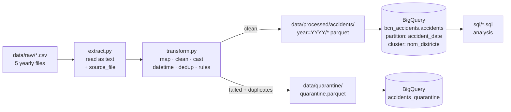

# Barcelona Traffic Accidents ETL

A small batch pipeline that takes five years (2021–2025) of Barcelona traffic accident
records from Open Data BCN and turns them into a clean, typed, partitioned table in
BigQuery.

**CSV → Polars (lazy) → Parquet → BigQuery**

## What it does

1. **Extract**: reads the five yearly CSVs as text. Handles a UTF-8 BOM, quoted vs
   unquoted files, padded headers, and falls back to cp1252 or `;` if a future file
   changes encoding or separator. Adds a `source_file` column.
2. **Transform** (Polars lazy API):
   - one column mapping from every header variant to `lowercase_snake_case`
   - safe casts: bad values become null and never crash the run
   - `accident_datetime` / `accident_date` built from year, month, day and hour (impossible dates become null)
   - `Desconegut` / `-1` and similar placeholders become null
   - one row per `numero_expedient`
   - quality rules: coordinates inside Barcelona's bounding box, counts ≥ 0, valid date
3. **Quarantine**: every row that fails a rule, and every dropped duplicate, is written to
   `data/quarantine/quarantine.parquet` with a `quality_issues` reason. No row is
   dropped silently. The run checks that `raw = clean + quarantine`.
4. **Load**:
   - Writes Parquet partitioned by year.
   - Loads BigQuery with a single Parquet load job (`WRITE_TRUNCATE`, so reruns are idempotent).
   - The table is partitioned by `accident_date` and clustered by `nom_districte`.



## Project layout

```
src/etl/extract.py     read CSVs, encoding/separator handling
src/etl/transform.py   mapping, cleaning, types, dedup, quality rules, report
src/etl/load.py        Parquet writing and BigQuery load
run.py                 runs the whole pipeline
run_queries.py         runs sql/*.sql against BigQuery and prints results
sql/                   analysis queries
tests/                 pytest tests using small hand-made DataFrames
```

## How to run

Requires Python 3.11+ and `gcloud auth application-default login` (no key files).

```bash
python -m venv .venv
source .venv/Scripts/activate        # Git Bash on Windows; .venv/bin/activate on macOS/Linux
pip install -r requirements.txt

# .env
# GCP_PROJECT=your-project-id
# BQ_DATASET=bcn_accidents            (dataset must already exist)

pytest                               # 20 tests, no cloud access needed
python run.py --skip-bigquery        # local Parquet only
python run.py                        # full pipeline incl. BigQuery load
python run_queries.py                # run the analysis queries
```

Put the yearly CSVs in `data/raw/` (`2021_accidents_gu_bcn.csv` … `2025_accidents_gu_bcn.csv`).

## Results

Quality report from a full run:

```
raw rows        : 38,659
clean rows      : 38,616
quarantined rows: 43
  - missing_coordinates: 24          (all in 2021)
  - duplicate_numero_expedient: 19
unknown -> null in clean data: nom_districte=171, nom_barri=171, nom_carrer=1
clean rows per year: 2021=7,629, 2022=7,989, 2023=7,721, 2024=7,536, 2025=7,741
```

| | Size |
|---|---|
| 5 CSV files | 8.08 MB |
| Parquet, partitioned by year (zstd) | 1.48 MB (**18%** of CSV) |

Parquet is smaller because it stores data by column with typed encodings and
compression. Columns like district and month repeat the same few values thousands of
times, and those compress very well.

## What differed between the yearly files

All five files are valid UTF-8, comma-separated, CRLF. The differences were in format,
headers and how zeros and unknowns are written:

| Difference | Years | Handling |
|---|---|---|
| UTF-8 BOM at file start | 2024, 2025 | stripped in extract |
| Every field quoted | 2023 | handled by the CSV parser |
| Values padded with spaces (`"2023S000001    "`, street names to 50 chars) | 2021–2023 | `strip_chars` on all text |
| `Longitud` / `Latitud` instead of `Longitud_WGS84` / `Latitud_WGS84` | 2022 | both map to `longitude` / `latitude` (coalesced) |
| `Num_postal_caption` vs `Num_postal ` (trailing space) | 2021–22 vs 2023+ | header trimmed; both map to `num_postal` |
| UTM headers labelled Y, X but the values are still X, Y | 2023–2025 | values swapped back when `utm_x > utm_y` (X ≈ 430k, Y ≈ 4.58M in Barcelona) |
| Zero counts written as blank instead of `0` | 2024, 2025 | blank count → 0; non-numeric text → null → quarantine |
| "No és causa del vianant" written as blank | 2024, 2025 | blank → "No és causa del vianant" (share is ~93.5% in every year, so it is the same meaning) |
| `Desconegut` / `-1` for unknown location | 2021–2023 | → null |
| Repeated case numbers (one row per pedestrian cause) | 2021–2023 | keep first row, rest to quarantine |

**Why 2024 is ~40% smaller than 2023:** it is not missing data. Row counts are almost the
same (7,536 vs 7,724). 2023 carried about 300 KB of space padding and 250 KB of quote
characters, and wrote out `0` and "No és causa del vianant" on every row. 2024 drops all
of that.

**2025 is a full year:** it covers 1 January to 31 December.

## Analysis (BigQuery)

`sql/01_accidents_by_district_per_year.sql` uses `PIVOT`. Eixample has the most accidents
every year (≈1,900–2,250), about twice the next district, Sant Martí.

`sql/02_most_dangerous_hours.sql`: the most accidents happen at 14:00, then 13:00 and 17:00.
Severity (serious injuries + deaths per 100 accidents) is highest in the evening:
3.29 at 18:00 and 3.71 at 20:00.

`sql/03_injuries_trend.sql`:

| year | accidents | minor | serious | deaths | victims | victims YoY |
|---|---|---|---|---|---|---|
| 2021 | 7,629 | 8,656 | 166 | 12 | 8,834 | |
| 2022 | 7,989 | 8,883 | 174 | 24 | 9,081 | +2.8% |
| 2023 | 7,721 | 8,550 | 226 | 21 | 8,797 | −3.1% |
| 2024 | 7,536 | 8,246 | 254 | 11 | 8,511 | −3.3% |
| 2025 | 7,741 | 8,376 | 249 | 11 | 8,636 | +1.5% |

Accidents are flat. Serious injuries rose about 50% from 2021 to 2024–25, while deaths
halved after 2023.

`sql/04_weekday_vs_weekend.sql`, averaged per calendar day: weekdays average 23.5
accidents/day and weekends 15.4. Weekend accidents are slightly more severe (3.18 vs 2.92
serious or fatal per 100).

## Design choices

- **Lazy API.** The transform is one query plan, so Polars can optimise it (projection
  pushdown, fusing expressions) before running anything.
- **Small pure functions.** Each step is `LazyFrame -> LazyFrame` and has its own test.
- **Stable schema.** The column mapping always outputs every target column (null if a
  year lacks it), so a file that drops a column does not break the pipeline.
- **One BigQuery load job.** All years load in one `WRITE_TRUNCATE` job, so the table is
  replaced atomically. Per-year jobs with `WRITE_TRUNCATE` would overwrite each other.
- **Monthly partitions.** 38k rows over five years would make daily partitions tiny.
  Monthly (60 partitions) still prunes date filters.
- **`DATETIME`, not `TIMESTAMP`.** The source has local Barcelona time with no time zone.
- **Dedup trade-off.** The duplicate rows differ only in pedestrian cause, so keeping one
  row loses the second cause for 19 accidents. Those rows are still in quarantine. A
  separate `accident_causes` table would keep them if needed.

## Polars vs Spark, BigQuery vs Databricks

**Polars vs Spark**
- **Polars** runs on one machine, is fast (Rust, multi-threaded, columnar) and needs no
  cluster. It suits data up to tens or low hundreds of GB, and is quick to start and test.
  It is the right fit here, at 8 MB.
- **Spark** spreads work across a cluster. Choose it when data does not fit on one machine
  (TB+), when you need distributed joins and shuffles, or when the platform already runs on
  Spark (Databricks, EMR). The cost is cluster start-up time, more configuration, and
  slower local tests.
- Both have a lazy DataFrame API with a query optimiser, so the code style moves across easily.

**BigQuery vs Databricks**
- **BigQuery** is a serverless SQL warehouse: nothing to manage, pay per query or slot,
  with partitioning and clustering for cost control. It is strong for SQL analytics and BI
  on Google Cloud.
- **Databricks** is a lakehouse platform built on Spark and Delta Lake on your own cloud
  storage. It is strong for mixed workloads: heavy Python/Spark ETL, streaming and ML on
  the same data, and teams who want open table formats and multi-cloud.
- Rule of thumb: mostly SQL analytics on GCP → BigQuery. Mostly code-heavy data
  engineering or ML, or an existing Spark / Delta estate → Databricks.

## Data source

Data: **"Accidents managed by the local police (Guàrdia Urbana)"**, Open Data BCN,
Ajuntament de Barcelona, licensed under
[CC BY 4.0](https://creativecommons.org/licenses/by/4.0/).
Source: <https://opendata-ajuntament.barcelona.cat/>.
